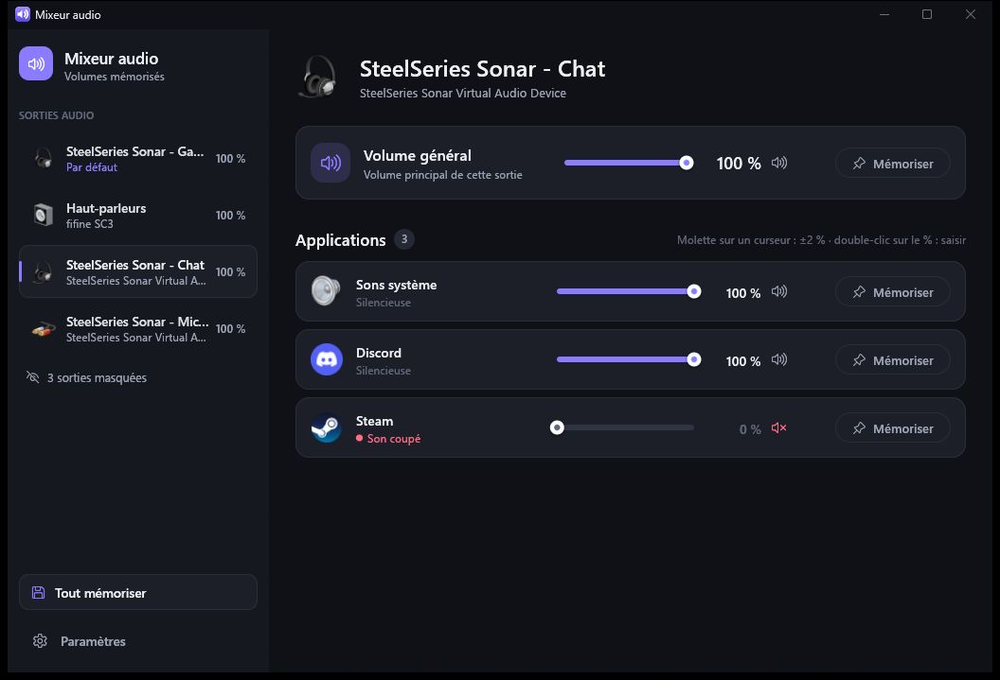

# NovaMixeur

*Formerly "Mixeur audio".*

🇫🇷 [Version française](README.md)

Volume mixer for Windows 10 / 11: set the volume of every audio output and every
app, and **save it** so it is reapplied after the PC restarts.

## Download

👉 **[Download the latest version](https://github.com/AestasDev/NovaMixeur/releases/latest)**
(file `NovaMixeur-Setup-x.y.z.exe`)

1. Run the installer: it installs for your account, without administrator rights,
   with a Start menu shortcut and, if you leave it checked, start with Windows. The
   installer and the app are in English or French depending on your Windows language.
2. The installer is not digitally signed: if Windows SmartScreen shows "Windows
   protected your PC", click **More info** then **Run anyway**.

Windows 10 or 11, 64-bit.

## How to use it

- **Sidebar**: your audio outputs (headset, speakers, monitors…). Click an output to
  see its master volume and the volume of each app on that output (Windows keeps a
  separate volume per app *and* per output). **Right-click → Hide** to hide an
  output you don't use.
- **Sliders**: drag, click, or use the **mouse wheel** (±2% per notch).
  **Double-click the percentage** to type a value, then Enter (Escape cancels).
- **Level meters**: the green bar under each slider shows the sound being played.
- **Save**: the volume (and mute) is reapplied when the PC starts and every time the
  app restarts. Click "Saved" again to forget it.
- **Lock** (next to "Saved"): the volume is enforced again as soon as something
  changes it (the app itself, Windows, another program).
- **Save all**: saves the current state of everything at once.

## Profiles

A profile stores the current volumes of all your outputs and apps under a name
("Gaming", "Work", "Night"…) so you can recall them in one click.

- **Create**: **+** button in the "Profiles" block of the sidebar, type a name and
  press Enter.
- **Apply**: click the profile (sidebar, mini panel or the menu of the icon near the
  clock). Volumes are set right away and saved, so they also apply to apps started
  later.
- **Right-click** a profile to update it with the current volumes, rename it or
  delete it.

## Icon near the clock and mini panel

- **Click** the icon: a **mini panel** opens right above it, with the master volume of
  the default output, the volume of each app and your profiles. It closes as soon
  as you click elsewhere (or press Escape).
- **Double-click**: opens the full mixer window.
- **Right-click**: menu (open the mixer, profiles, quit).
- The window's ✕ button hides it: the mixer keeps running.

## Settings

- **Start with Windows**: the mixer starts hidden in the notification area and
  reapplies your volumes.
- **Minimize to the notification area** instead of quitting (on by default).
- **Start menu shortcut**.
- **Theme**: System / Light / Dark.
- **Language**: Automatic (Windows language) / Français / English.
- **Hidden outputs**: to show them again.
- **Automatic updates** (on by default): every 6 hours the mixer checks whether a new
  version is published, downloads it, verifies its fingerprint, installs it
  silently as soon as its window is minimized near the clock, and restarts on its
  own. A "Check now" button checks right away.

Your settings are stored in `%APPDATA%\NovaMixeur\config.json`.

## Command line

`novamixeur.exe --set discord.exe 40` sets an app's volume on the default output
(handy with a Stream Deck or a shortcut).

## RivaTuner / MSI Afterburner counters in the window

The mixer is drawn with OpenGL (much lighter on memory). If you use RivaTuner
Statistics Server, it may draw its counters (GPU, CPU, FPS…) in the mixer window.
To remove them: in RivaTuner, click **+** at the bottom left, pick
`novamixeur.exe` (in its install folder), then set **Application detection
level** to **None**.

## Uninstall

Windows Settings → Apps → NovaMixeur. Your saved volumes are kept, unless you
choose to delete them.
