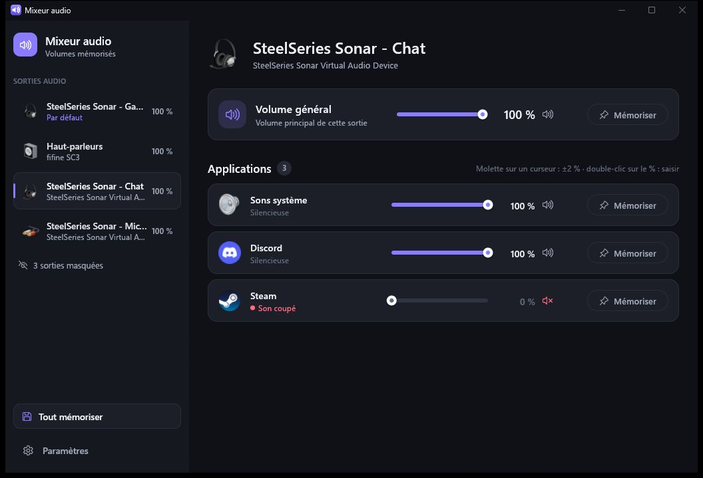

# NovaMixeur

*Anciennement « Mixeur audio ».*

🇬🇧 [English version](README.en.md)

Mixeur de volume pour Windows 10 / 11 : réglez le volume de chaque sortie audio et
de chaque application, et **mémorisez-le** pour qu'il soit réappliqué après un
redémarrage du PC.

## Télécharger

👉 **[Télécharger la dernière version](https://github.com/AestasDev/NovaMixeur/releases/latest)**
(fichier `NovaMixeur-Setup-x.y.z.exe`)

1. Lancez l'installateur : l'installation se fait pour votre compte, sans droits
   administrateur, avec un raccourci dans le menu Démarrer et, si vous le laissez
   coché, le lancement au démarrage de Windows.
2. L'installateur n'est pas signé numériquement : si Windows SmartScreen affiche
   « Windows a protégé votre ordinateur », cliquez sur **Informations
   complémentaires** puis **Exécuter quand même**.

Windows 10 ou 11, 64 bits.

## Utilisation

- **Barre latérale** : vos sorties audio (casque, enceintes, écrans…). Cliquez sur une
  sortie pour voir son volume général et le volume de chaque application sur cette
  sortie (Windows garde un volume séparé par appli *et* par sortie).
  **Clic droit → Masquer** pour cacher une sortie inutile.
- **Curseurs** : glisser, cliquer, ou **molette de la souris** (±2 % par cran).
  **Double-cliquer sur le pourcentage** pour taper une valeur, puis Entrée (Échap
  annule).
- **Vumètres** : la barre verte sous chaque curseur montre le son joué en direct.
- **Mémoriser** : le volume (et la sourdine) est réappliqué au démarrage du PC et à
  chaque fois que l'application se relance. Recliquer sur « Mémorisé » l'oublie.
- **Verrou** (à côté de « Mémorisé ») : le volume est ré-imposé immédiatement dès que
  quelque chose le modifie (l'application elle-même, Windows, un autre logiciel).
- **Tout mémoriser** : mémorise d'un coup l'état actuel de tout.

## Profils

Un profil enregistre les volumes actuels de toutes vos sorties et applications sous
un nom (« Jeu », « Travail », « Nuit »…) pour les rappeler d'un clic.

- **Créer** : bouton **+** du bloc « Profils » de la barre latérale, puis tapez un nom
  et Entrée.
- **Appliquer** : clic sur le profil (barre latérale, mini-panneau ou menu de
  l'icône près de l'horloge). Les volumes sont réglés tout de suite et mémorisés,
  donc aussi appliqués aux applications lancées plus tard.
- **Clic droit** sur un profil : le mettre à jour avec les volumes actuels, le
  renommer ou le supprimer.

## Icône près de l'horloge et mini-panneau

- **Clic** sur l'icône : un **mini-panneau** s'ouvre juste au-dessus, avec le volume
  général de la sortie par défaut, le volume de chaque application et vos profils.
  Il se ferme dès que vous cliquez ailleurs (ou Échap).
- **Double-clic** : ouvre la fenêtre complète du mixeur.
- **Clic droit** : menu (ouvrir le mixeur, profils, quitter).
- Le bouton ✕ de la fenêtre la cache : le mixeur continue de tourner.

## Paramètres

- **Lancer au démarrage de Windows** : le mixeur démarre caché dans la zone de
  notification et réapplique vos volumes.
- **Réduire dans la zone de notification** au lieu de quitter (activé par défaut).
- **Raccourci dans le menu Démarrer**.
- **Thème** : Système / Clair / Sombre.
- **Langue** : Automatique (celle de Windows) / Français / English.
- **Sorties masquées** : pour les réafficher.
- **Mises à jour automatiques** (activées par défaut) : le mixeur vérifie toutes les
  6 heures si une nouvelle version est publiée, la télécharge, vérifie son
  empreinte, puis l'installe en silence dès que sa fenêtre est réduite près de
  l'horloge, et redémarre tout seul. Un bouton « Rechercher » permet de vérifier
  tout de suite.

Vos réglages sont enregistrés dans `%APPDATA%\NovaMixeur\config.json`.

## Ligne de commande

`novamixeur.exe --set discord.exe 40` règle une application sur la sortie par
défaut (pratique avec un Stream Deck ou un raccourci).

## Compteurs RivaTuner / MSI Afterburner dans la fenêtre

Le mixeur s'affiche avec OpenGL (bien plus léger en mémoire). Si vous utilisez
RivaTuner Statistics Server, il peut dessiner ses compteurs (GPU, CPU, FPS…) dans
la fenêtre du mixeur. Pour les retirer : dans RivaTuner, cliquez sur **+** en bas à
gauche, choisissez `novamixeur.exe` (dans son dossier d'installation), puis
réglez **Application detection level** sur **None**.

## Désinstaller

Paramètres Windows → Applications → NovaMixeur. Vos volumes mémorisés sont
conservés, sauf si vous choisissez de les supprimer.
